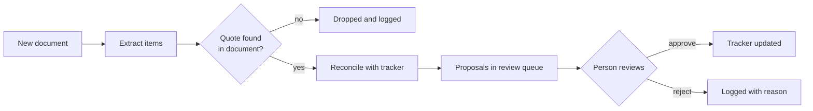

# Foreman

An AI teammate for a civil engineering firm's project managers. Foreman reads client emails,
meeting notes and RFIs, works out what they mean for the project tracker, and proposes the
changes. A person approves every change before anything is written.

> **About the data:** every client, project, person and document in this repo is fictional,
> created for this demo. This is a personal project. It contains no employer or client code,
> data, or proprietary information.


## The problem

At a small engineering firm, project managers keep a task tracker for each project and update
it by hand after every email and meeting. Requests buried in email threads never reach the
tracker. A client moves a date in a reply and the tracker keeps the old one. Work stalls waiting
on the client, and nobody is tracking what is being waited on. Writing a status update takes an
hour of re-reading. (Full brief: [docs/workflow-brief.md](docs/workflow-brief.md).)

## What Foreman does

1. **Reads** each new document and extracts requests, action items, deadlines and decisions,
   each with the exact quote it came from.
2. **Reconciles** them with the tracker: new work, an update to an existing task, or a conflict
   with what the tracker says.
3. **Proposes** changes to a review queue. The agent cannot write to the tracker directly.
4. **Applies** a change only when a person approves it.
5. **Reports:** answers "what's outstanding?" and drafts a client status update with citations,
   which also goes through review.

## How it works



The intake flow is a LangGraph graph. Every document ends with an explicit outcome
(`proposed`, `no_changes`, `no_items` or `needs_manual_review`), so nothing disappears silently.

**The model does the fuzzy work; code enforces the rules.** The model reads documents and matches
items to tasks. Plain Python decides everything that must be reliable:

| Rule                                                         | Enforced in code                                    |
| ------------------------------------------------------------ | --------------------------------------------------- |
| Every extracted item must quote the document word for word   | Items whose quote isn't in the document are dropped |
| An owner must be named in the quoted evidence                | A name only in the greeting ("Hi Sam") is cleared   |
| Changing an existing date or owner is a conflict             | Flagged for review, never applied silently          |
| Nothing changes without approval                             | The agent can only write to `proposed_changes`      |
| Approvals are all or nothing                                 | Task change and decision saved in one transaction   |
| A proposal can't be applied twice, or after the task changed | Double decisions and stale proposals are refused    |
| Client emails only state supported facts                     | Paragraphs citing no valid fact are flagged         |

## Measuring reliability

Extraction is scored against 15 hand-labeled documents (22 expected items), written before the
agent existed and chosen to include hard cases: a date corrected mid-email, a request phrased as
a question, one email covering two projects, a document with nothing to extract.
Labeling rules: [evals/LABELING.md](evals/LABELING.md).

|                                      | Precision   | Recall      |
| ------------------------------------ | ----------- | ----------- |
| Baseline                             | 0.68        | 0.86        |
| After 4 rounds of changes (two runs) | 0.86 / 0.90 | 0.86 / 0.82 |

Each run is repeated, because scores swing 5-9 points between identical runs at this size.
Every change, its cause (code, prompt, or answer key) and its measured effect is in
[evals/CHANGELOG.md](evals/CHANGELOG.md), including a rule that made things worse and was
reverted.

## Design decisions

- **Proposals instead of direct writes.** Trust is earned per action. Starting with human review
  for everything makes the system safe while it is imperfect.
- **Code checks instead of more prompt rules.** When a prompt rule fixed something only some of
  the time (greeting treated as owner), the check moved into code, and the problem stopped.
- **Postgres full-text search, no vector database.** Search is scoped to one project's few dozen
  documents; keyword search is accurate there and easy to debug.
- **The reconciler sees the original document.** Extraction correctly drops background facts
  ("the form is signed"), but reconciliation needs them to unblock tasks.
- **Provider-agnostic.** The model is set in `.env`; moving from Gemini to OpenAI took two lines.
- **The UI has no business logic.** Every safety rule lives in `app/` and applies whether a
  decision comes from the web app or a script.

## Limitations

Known issues, all caught by the review step rather than reaching the tracker:

- Two documents can propose the same new task; reconciliation doesn't yet check the review queue.
- Reconciliation sometimes matches on a date or event mentioned rather than the work itself.
- Reprocessing a document adds a second set of results instead of replacing the first.
- Three borderline extraction cases still fail intermittently (see the changelog).
- Task notes can pick up background details from the document.
- The citation check proves cited facts exist, not that a sentence describes them faithfully.

## Run it

Requires Python 3.11+, Docker, and an OpenAI API key (or another provider supported by LangChain).

```bash
git clone https://github.com/Mihir16x/foreman-agent.git
cd foreman-agent
python -m venv .venv
source .venv/bin/activate          # Windows: .venv\Scripts\Activate.ps1
pip install -r requirements.txt
cp .env.example .env               # then add your API key
docker compose up -d

python scripts/init_db.py          # tables, 4 projects, 24 tasks
python -m scripts.load_inbox       # 15 fictional documents
python -m scripts.run_intake       # Foreman reads them (about 30 model calls)
python -m streamlit run ui/streamlit_app.py
```

Tests and evals:

```bash
python -m pytest                   # 18 tests: tools, reconciliation rules, approvals, prompts
python -m evals.run_eval           # extraction precision and recall
```

## Project structure

```
app/
  extract.py        extraction, quote and owner checks
  reconcile.py      matching items to tasks; conflict rule
  review.py         approvals: transactions, stale checks
  status.py         cited status updates
  graph/intake.py   LangGraph intake flow
  prompts.py, models.py, tools.py, db.py
db/                 schema and seed data
evals/              15 labeled cases, scorer, labeling rules, changelog
ui/                 Streamlit app
tests/              pytest suite
docs/               workflow brief, screenshots
```

## Built with

Python, LangGraph, LangChain, OpenAI gpt-5-mini, PostgreSQL, Streamlit, pytest, Docker.
